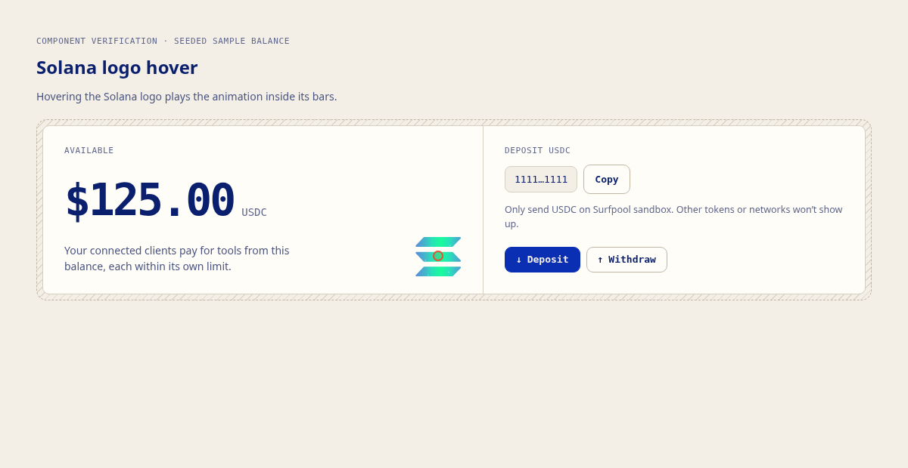

# Solana logo hover proof

[Watch the browser recording](proof.webm) · [Browser check results](results.json)

The recording renders the actual `WalletPanel` component and application stylesheet in a temporary local Vite harness with a seeded sample balance. No live wallet authentication, payment, or RPC was exercised. The red ring marks the pointer and the captions describe each interaction.

The recording shows the balance panel staying idle, the logo animating on hover, the animation stopping when the pointer returns to the balance label, re-hover starting it again, and reduced motion showing static brand colours. Additional browser checks passed for dark mode and a mobile touch context.

Validation: 15 Chromium browser checks passed; formatting, ESLint for the changed components, web TypeScript checks, production web build with `VITE_SOLANA_NETWORK=devnet`, and `git diff --check` passed. The build emitted Vite configuration and chunk-size warnings. The full repository `bun run check` was not run because Bun is unavailable in this environment.
